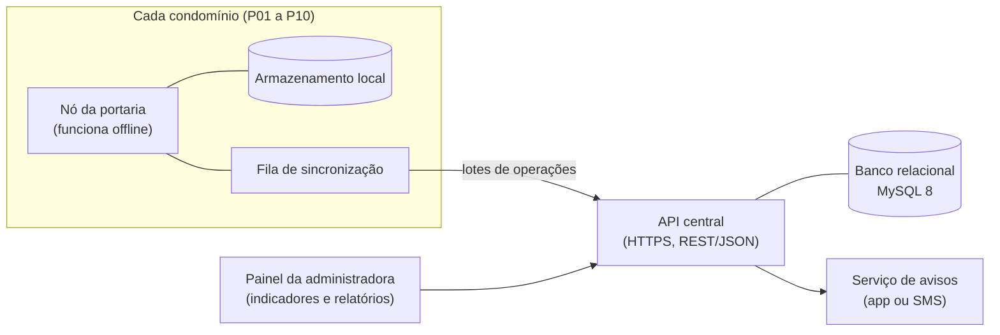

# Arquitetura do sistema (Etapa 3)

> Roteiro de tópicos para o capítulo 4. As decisões que sustentam esta arquitetura estão em [`decisoes/`](decisoes/).

## 1. Sistema completo (projetado e documentado)

| Componente | Responsabilidade |
|---|---|
| Nó da portaria | Registrar, alocar, avisar e controlar retiradas, mesmo sem internet |
| Servidor central (API + banco) | Receber as operações, aplicá-las uma única vez e guardar os dados de todos os condomínios |
| Painel da administradora | Indicadores e relatórios |
| Canais de aviso | Aplicativo, SMS ou interfone com código impresso |

## 2. Camadas do nó da portaria

| Camada | Conteúdo | Módulos (protótipo em C) |
|---|---|---|
| Interface de console | Menu e leitura segura do teclado | `portaria.c`, `util` |
| Regras de negócio | Cadastro, alocação, código, registro, retirada, aviso e relatórios | `morador`, `estante`, `codigo`, `encomenda`, `retirada`, `aviso`, `relatorio` |
| Persistência | Leitura e gravação dos arquivos CSV | `persistencia` |
| Fila de sincronização | Operações pendentes de envio | `sincronizacao` |

Regra de dependência: cada camada só chama a de baixo. O `main` contém apenas menu e chamadas.

## 3. Protótipo × sistema completo

| Protótipo em C | Sistema completo |
|---|---|
| Executável `portaria` | Nó da portaria |
| Arquivos em `dados/portarias/` | Armazenamento local que permite operar offline |
| Arquivos em `dados/rede/` | Envio pela rede (HTTPS para a API central) |
| Executável `central` | Servidor central e banco relacional |

Fora do protótipo (evolução futura): app do morador e painel web reais, envio real de SMS ou WhatsApp, sockets, interface gráfica, fotos, armários inteligentes e ligação do C com o MySQL. O banco é modelado e testado com scripts SQL à parte.

## 4. Fluxo de dados principal

1. Porteiro registra a encomenda → o módulo `encomenda` pede posição ao `estante` e código ao `codigo`.
2. `persistencia` grava a encomenda; `sincronizacao` acrescenta a operação REGISTRO na fila; `aviso` registra o aviso.
3. Na retirada, `retirada` confere o código, atualiza a encomenda e acrescenta a operação RETIRADA.
4. Com a portaria online, a fila é copiada para `dados/rede/Pnn.log`.
5. A `central` lê os logs, aplica cada operação uma única vez e gera o relatório consolidado.

## 5. Decisões de arquitetura

| ID | Decisão | Arquivo |
|---|---|---|
| ADR-001 | Banco relacional (MySQL 8) no servidor central; NoSQL só discutido | [`decisoes/adr-001-banco-relacional.md`](decisoes/adr-001-banco-relacional.md) |
| ADR-002 | Dados do protótipo em CSV separado por `;` | [`decisoes/adr-002-armazenamento-csv.md`](decisoes/adr-002-armazenamento-csv.md) |
| ADR-003 | Sincronização assíncrona com fila de operações idempotentes | [`decisoes/adr-003-sincronizacao-assincrona.md`](decisoes/adr-003-sincronizacao-assincrona.md) |
| ADR-004 | Scrum com sprints de 1 semana | [`decisoes/adr-004-scrum.md`](decisoes/adr-004-scrum.md) |
| ADR-005 | Diagramas como código (PlantUML e Mermaid) | [`decisoes/adr-005-diagramas-como-codigo.md`](decisoes/adr-005-diagramas-como-codigo.md) |
| ADR-006 | Endereçamento 10.X.Y.0/24 | [`decisoes/adr-006-enderecamento-ip.md`](decisoes/adr-006-enderecamento-ip.md) |

Os detalhes de rede ficam em `06-redes/`; os de banco, em `04-banco-de-dados/`.
