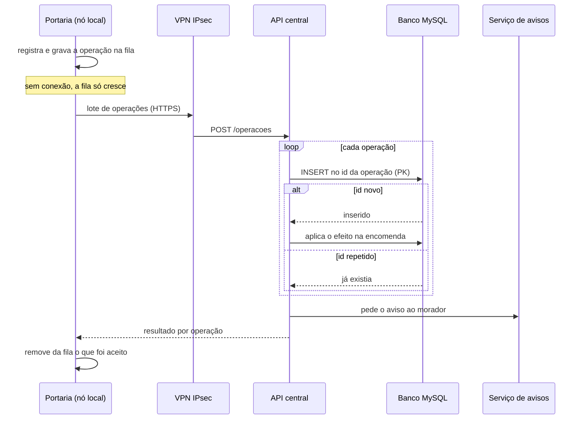

# Nuvem e sistemas distribuídos (Etapa 6)

> Roteiro para o capítulo 7, que o grupo redige. Os conceitos abaixo são gerais; antes de citar no trabalho, o grupo deve conferi-los nas fontes B07, B08 e B09 de `02-pesquisa/fontes.md` `[FONTE A VERIFICAR]`. Decisões relacionadas: [ADR-001](../03-engenharia-software/decisoes/adr-001-banco-relacional.md) e [ADR-003](../03-engenharia-software/decisoes/adr-003-sincronizacao-assincrona.md).

## 1. Modelos de serviço em nuvem

| Modelo | O que o provedor entrega | O que o cliente cuida | No projeto |
|---|---|---|---|
| IaaS (infraestrutura) | Máquinas virtuais, rede e armazenamento | Sistema operacional, atualizações e aplicação | Máquina virtual que roda a API (uma das opções) |
| PaaS (plataforma) | Ambiente pronto, com atualização e backup gerenciados | A aplicação e os dados | **MySQL gerenciado**; contêiner para a API (a outra opção) |
| SaaS (software) | O software pronto para uso | Apenas o uso e a configuração | Serviço de avisos por SMS ou app, contratado de terceiros |

## 2. Decisão para este projeto

| Parte | Escolha | Justificativa |
|---|---|---|
| Banco de dados | **PaaS** (MySQL 8 gerenciado) | Backup, atualização e disponibilidade ficam com o provedor; o grupo não precisa administrar o servidor de banco |
| API central | **Máquina virtual ou contêiner** | Controle do ambiente da aplicação e escala horizontal (mais instâncias) |
| Avisos | **SaaS** de terceiros | Não faz sentido construir um serviço de SMS |

## 3. Nuvem × servidor próprio na sede

Comparação qualitativa, sem números (valores dependem de cotação: [A COTAR]).

| Critério | Nuvem | Servidor na sede |
|---|---|---|
| Custo | Mensal e proporcional ao uso | Investimento inicial alto, mais energia, climatização e espaço |
| Disponibilidade | Provedor oferece redundância | Depende de energia e internet da sede; um ponto único de falha |
| Manutenção | Parte gerenciada pelo provedor | Toda por conta da administradora (peças, atualização, backup) |
| Escalabilidade | Aumenta instâncias sob demanda | Exige comprar e instalar hardware |
| Acesso dos 10 condomínios | Ponto central na internet, com VPN | Os 10 condomínios dependeriam da conexão da sede |
| Controle e LGPD | Precisa escolher onde os dados ficam e contratar com cuidado | Controle físico total, com a responsabilidade de proteger |
| Dependência de fornecedor | Existe | Menor |

Conclusão proposta: nuvem, porque os 10 condomínios precisam de um ponto comum disponível e a administradora não tem equipe de infraestrutura para manter servidores. A decisão final e o provedor ficam com o grupo.

## 4. Comunicação entre serviços

| De | Para | Como | Rede |
|---|---|---|---|
| Portaria (nó local) | API central | HTTPS (REST, JSON), em lotes da fila de sincronização | VPN IPsec, porta 443 |
| Painel da administradora | API central | HTTPS (REST, JSON), consultas | VPN a partir da sede |
| API central | Banco | MySQL (porta 3306) | Sub-rede privada `172.16.2.0/24` |
| API central | Serviço de avisos | Chamada à API do provedor | Saída da sub-rede pública |

No protótipo em C, os arquivos de `dados/rede/` fazem o papel dessa comunicação.

### Proposta de contrato do envio de lote

Proposta de projeto, **não implementada**. Dados fictícios.

```
POST /api/v1/portarias/P01/operacoes        (HTTPS, dentro da VPN)
{
  "operacoes": [
    { "id_operacao": "P01-000011", "tipo": "REGISTRO", "data_hora": "2026-10-29T18:58:00",
      "id_encomenda": 9, "bloco": "A", "apartamento": 12 },
    { "id_operacao": "P01-000012", "tipo": "RETIRADA", "data_hora": "2026-10-29T19:10:00",
      "id_encomenda": 9, "bloco": "A", "apartamento": 12 }
  ]
}

Resposta 200
{
  "resultados": [
    { "id_operacao": "P01-000011", "situacao": "APLICADA" },
    { "id_operacao": "P01-000012", "situacao": "JA_APLICADA" }
  ]
}
```

Reenviar o mesmo lote é seguro: a API aplica cada `id_operacao` uma única vez (chave primária em `operacao_sincronizacao`) e responde `JA_APLICADA` para as repetidas. Uma operação cujo efeito não faz sentido volta como `REJEITADA`, e o nó pode reenviá-la depois, como a central do protótipo faz.



## 5. Sistema distribuído

| Característica | Como o projeto trata |
|---|---|
| Nós autônomos | Cada portaria guarda seus dados e funciona sozinha (RNF01, ADR-002) |
| Sincronização assíncrona | O envio acontece quando há conexão, por uma fila persistente (ADR-003) |
| Consistência eventual | A central converge para o estado das portarias quando as operações chegam |
| Idempotência | O id da operação (`P01-000123`) é único; repetir não duplica |
| Ordem | Garantida dentro de cada portaria pela sequência; entre portarias não é necessária, pois cada encomenda pertence a uma só |
| Tolerância a falhas | Queda da internet, da VPN ou da nuvem não para a portaria; o reenvio é seguro |
| Reenvio seguro | Operações são copiadas antes de a fila ser esvaziada; uma queda no meio apenas repete operações |

Evidências no protótipo: o teste `test_consolidacao.c` mostra que processar o mesmo log duas vezes não duplica nada, e o `test_sincronizacao.c` mostra que a fila offline é preservada.

### Limites e riscos a mencionar

| Ponto | Observação |
|---|---|
| Relógio das portarias | A data e a hora da operação vêm do relógio do PC da portaria. Sem sincronização, os relógios podem divergir; usar NTP no roteador ou no PC [A DEFINIR] |
| Operação rejeitada | Se uma RETIRADA chegar antes do REGISTRO, ela é rejeitada e deve ser reenviada |
| Perda do arquivo de sequência | Recomeçar a numeração geraria ids já usados e a central os ignoraria; o número da próxima operação precisa ser preservado (ver README de `05-programa-c/`) |
| Avisos sem conexão | O aviso digital depende da nuvem; o interfone com código impresso cobre a falta |

## 6. Escalabilidade

| Dimensão | Como cresce |
|---|---|
| Novos condomínios | Novo nó, nova faixa `10.X.0.0/16`, nova VPN; o código não muda (RNF06) |
| Carga da API | Mais instâncias atrás de um balanceador (escala horizontal); a API é sem estado, pois o estado está no banco |
| Banco de dados | Índices (`encomenda (status, recebida_em)` e `encomenda (id_unidade)`); se crescer, réplicas de leitura para os relatórios |
| Capacidade do protótipo | O protótipo em C é limitado por constantes (500 encomendas por portaria; 20 000 operações na central); o sistema completo usa o banco |

Ponto de partida de volume: 10 condomínios, cerca de 960 unidades. Estimativas de crescimento só entram no texto com fonte.
